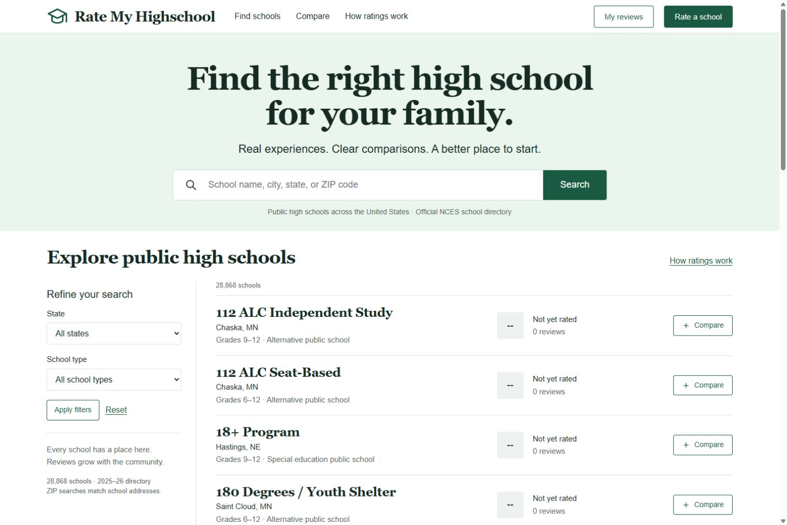

# Rate My Highschool

Search **28,868 public schools serving grades 9–12** across the 50 states and Washington, DC. Compare up to three schools, rate seven categories, and submit anonymous public reviews with a moderation and reporting workflow. Only approved reviews contribute to scores.

Built with React, Vinext, and Cloudflare D1. The real NCES directory is included; you do not need to download or import school data to run the app.



## Download and run

Requires **Node.js 22.13 or newer**, including npm, and an internet connection for the first dependency installation. Python **3.10 or newer** is optional and is needed only for the data importer and its tests.

1. Download the ZIP from [DakuraOfficial/Rate-My-Highschool](https://github.com/DakuraOfficial/Rate-My-Highschool) using **Code → Download ZIP**.
2. Extract the ZIP completely.
3. Open a terminal in the extracted folder containing `package.json`, then run:

```sh
npm run setup
npm run dev
```

Open [http://localhost:5173](http://localhost:5173). Keep the terminal open while using the app; press **Ctrl+C** to stop it.

On Windows, you can instead double-click **Start-Rate-My-Highschool.bat** in the extracted folder. The launcher prepares missing dependencies and the local database, then starts the app. Node.js must already be installed.

`npm run setup` installs the locked dependencies, builds the app, applies local database migrations, and creates `.dev.vars` from `.dev.vars.example` if it is missing. Migrations can be applied again safely. Local reviews and database state stay on your computer in ignored files.

## Try reviews and moderation

Click **Sign in** in the local app. Local development uses one simulated account, `local_seedy`; everyone using that preview shares this account. Setup configures it as the local moderator through `.dev.vars`.

Submit a review, visit **My reviews** to edit it, and use **Moderation** to approve or reject it. A pending review becomes public and affects scores only after approval. Ratings cover technology, learning, clubs, teachers, administration, safety, and culture. Relationship labels are self-reported.

## Development commands

```sh
npm run typecheck
npm test
npm run test:importer
npm run build
npm run db:migrate
```

`test:importer` requires Python. `db:migrate` applies pending migrations to the local D1 database. Generate a new migration after changing `db/schema.ts` with `npm run db:generate`.

The persistent API test is optional: it targets a running local preview when `API_TEST_BASE_URL` is set to `http://127.0.0.1:5173`. It requires the local moderator account and uses a clearly marked temporary review that must be cleaned up after testing.

## Hosting and account identity

Local sign-in is a development mock and is disabled in production. Real production accounts use the **Sites hosting integration**, which supplies authenticated visitor identity. Configure production moderator IDs privately through the site's runtime `MODERATOR_USER_IDS` value. A standalone deployment needs its own trusted authentication integration before account features can work.

The exported `.openai/hosting.json` contains the D1 binding configuration but no existing Sites project ID. The public GitHub repository shares source code; it does not change the audience or visibility of the separately hosted Sites app.

## School data

The included directory comes from the **NCES 2025–26 preliminary Common Core of Data directory**. Directory facts use the October 1, 2025 snapshot, with documented status updates evaluated as of October 13, 2026. Coverage follows that release and excludes records without documented grades 9–12.

See the [data import report](docs/data-import-report.md), [detailed audit](docs/import-report.json), and [source metadata](app/data/source.json) for provenance and coverage limits. `scripts/import-schools.py` reproduces the included data from the official source:

```sh
python scripts/import-schools.py --help
```

School data is served from the included files; D1 stores community reviews, reports, and moderation history. Third-party source notices are in [THIRD_PARTY_NOTICES.md](THIRD_PARTY_NOTICES.md).
